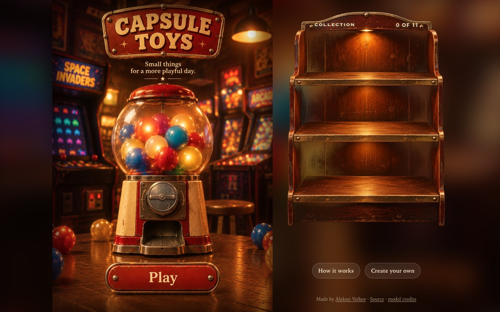
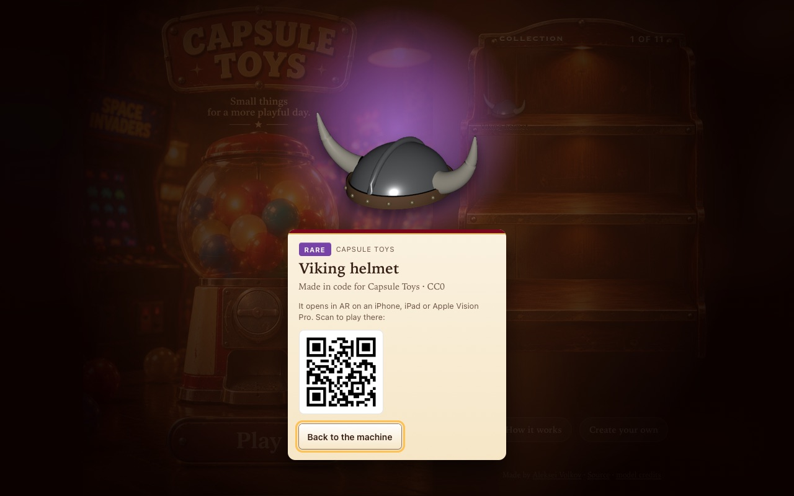
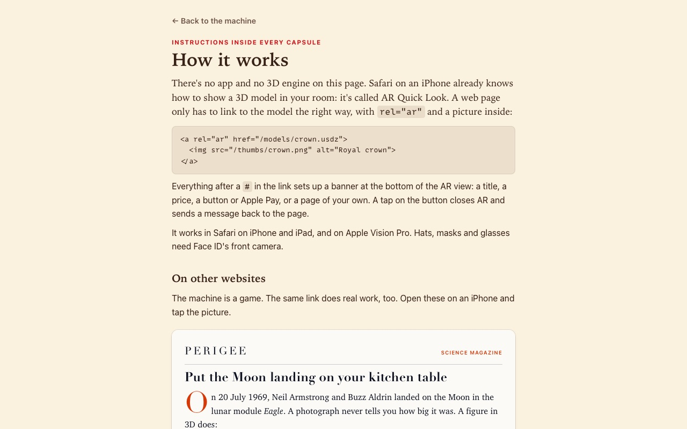

<div align="center">

# Capsule Toys

**A capsule toy machine for augmented reality.** Turn the knob: a capsule drops, pops open, and a random 3D model opens in AR on your iPhone.<br>
Hats and glasses go on your face; spacecraft and a scanned flat go on the floor. Close AR and the toy is on your shelf.

### [▶ Play at ar.avolkov.dev](https://ar.avolkov.dev)

AR needs Safari on an iPhone, iPad or Apple Vision Pro. On a Mac, Windows or Android the machine still plays and shows each toy with a QR code to continue on an iPhone.

<!-- Happy-path video: drag /private/tmp/claude-501/-Users-alex-Downloads-github/eba4b07d-fb10-47d6-8ce4-42740ad111e8/scratchpad/media/capsule-toys/capsule-toys-happy-path.mp4 onto this line in the GitHub editor -->

  

</div>

## The machine

There's no app and no 3D engine on the page: Safari's AR Quick Look does the 3D, and the page only links to `.usdz` files the right way (`rel="ar"`, a picture inside, the banner's options after the `#`). Eleven models in three rarities; the rare ones glow. What you've caught stays on the shelf on your device.

- [How it works](https://ar.avolkov.dev/how-it-works): AR from a single link, and two examples of the same link on other websites: a magazine figure that opens in your room, and a shop where you try a mask on and buy it inside AR.
- [Create your own](https://ar.avolkov.dev/create): paste a link to your own `.usdz`, set up the banner, copy the HTML.

The look is a 1970s arcade seen through early iOS: built from pictures, not geometry. The whole scene is one rendered image; the knob, the capsule and the display cabinet are separate renders laid over it by percentages (`art/`, `scripts/art.py`).

## The judge

The code was written with Claude Code; every model is checked by an independent judge before it goes in the machine: Apple's own `usdchecker --arkit`, plus `models/check.py` for what the game needs (face-anchored wear models, place models at their real size standing on the floor, under 6 MB, a thumbnail, and a licence that allows sharing). Vitest then reads every page the way Safari does: every AR link has an image as its first child, points to a file that exists, and carries exactly the fragment the link builder would write.

<details>
<summary>How the pieces fit</summary>

| Part | Where |
|---|---|
| The machine: knob, rattle, capsule reveal, shelf | `site/src/game.ts` |
| AR Quick Look links, and opening AR from code | `site/src/quicklook.ts` |
| The banner shown inside AR, one page per toy, written at build time | `site/src/banner.ts`, `vite.config.ts` |
| The catalog and the weighted random pick | `models/catalog.json`, `site/src/catalog.ts` |
| Wear models (front camera), generated in code | `models/wear.py` |
| Downloaded models, fixed for Quick Look (`MaterialBindingAPI`, RoomPlan's broken shading, size and floor) | `models/build.py` |
| Thumbnails, rendered with `usdrecord` | `models/thumbs.py` |
| The textures and icons, cut from the renders | `art/`, `scripts/art.py` |
| The judge | `models/check.py` |

The knob is a real ratchet: clockwise only, it keeps where you left it, clicks every 30°, and stops hard at a full turn. Safari opens AR only within a few seconds of a tap, so the whole sequence fits in two and a half. Hats and helmets carry an invisible head made with RealityKit's occlusion material, so the back of a crown doesn't draw over your forehead.

This repo started in 2023 as *What AR Quick Look can do today* (shop scenarios, mostly in Russian) and joins it with *randomARt* (2022). The 2023 version is at the [`legacy-2023`](https://github.com/slimcandy/capsule-toys/tree/legacy-2023) tag.

</details>

## Run it locally

Needs Node 24 or newer.

```sh
git clone --depth 1 https://github.com/slimcandy/capsule-toys.git
cd capsule-toys
npm install
npm run build && npm run preview   # http://localhost:4173/
```

`npm run dev` for a dev server, `npm test` for the tests, `npm run check` for TypeScript. The models are committed; to rebuild or judge them (macOS, for `usdchecker` and `usdrecord`): `python3 -m venv .venv && .venv/bin/pip install -r models/requirements.txt`, then `npm run models` and `npm run check-models`. Downloaded models go in `models/downloads/` (not committed) with an entry in `models/catalog.json`. The link-preview card comes from the page itself: `node scripts/share-card.mjs` against a running preview.

## Licence

Code: MIT, © 2023–2026 Aleksei Volkov. Wear models are made in code for Capsule Toys (CC0). Curiosity rover by [Thomas Flynn](https://sketchfab.com/3d-models/0696a383f3e841d2b5c7636ee8a58aba), Saturn V by [dannzjs](https://sketchfab.com/3d-models/9b61dbd396334aca8faac51f9ef63f2e) and the Apollo 11 lunar module by [NINATOR](https://sketchfab.com/3d-models/88cac6203b1c4860a269b674f6657105) are CC BY 4.0; the flat is the author's own RoomPlan scan.
